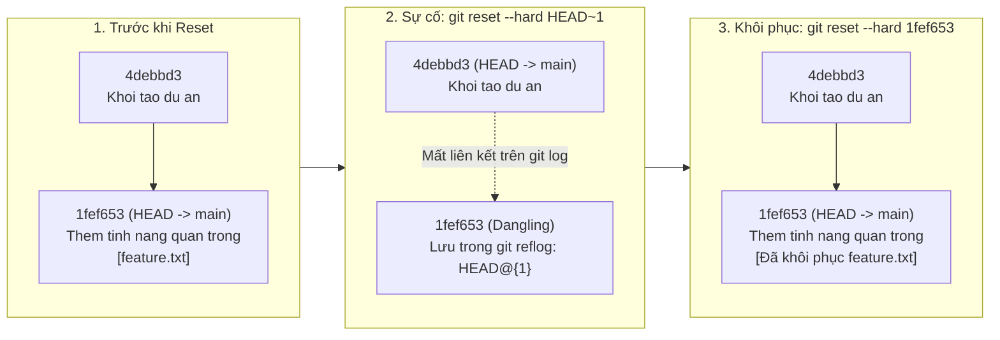
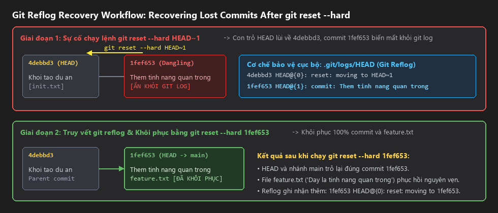
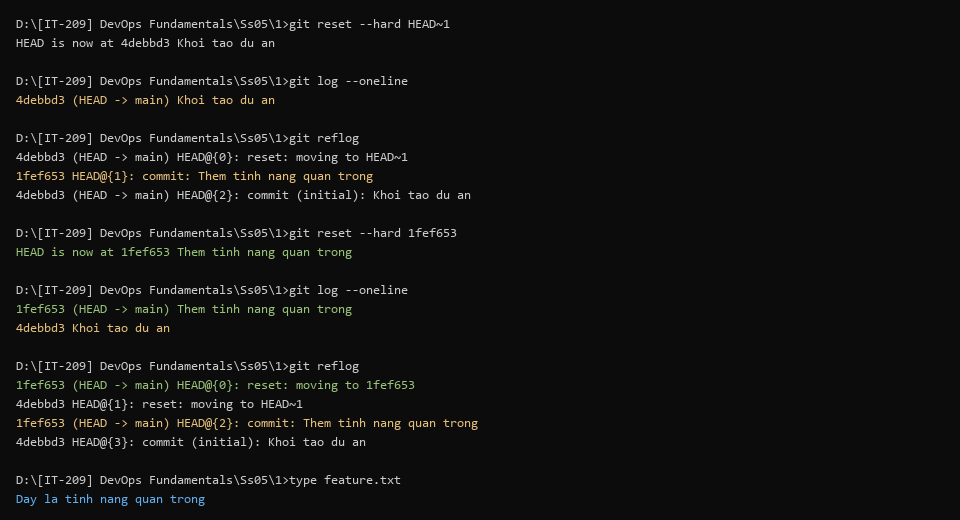

# Báo Cáo Bài Tập 1: Khôi Phục Commit Đã Mất Bằng Git Reflog

- **Môn học**: DevOps Fundamentals (IT-209)
- **Session**: 05 - Git Advanced & Recovery
- **Bài tập**: Bài 1 - Khôi phục commit đã mất bằng Git Reflog
- **Đường dẫn nộp bài trên GitHub**: `homework/session_05/ex1/`
- **Học viên**: HoQuocKhai
- **Email**: khaiho6040@gmail.com

---

## 1. Mục tiêu bài thực hành
1. **Hiểu cơ chế lưu trữ lịch sử cục bộ của Git thông qua Reflog**: Nắm vững cách Git ghi nhận mọi biến động của con trỏ `HEAD` và các nhánh trong `.git/logs/`.
2. **Sử dụng thành thạo lệnh `git reflog`**: Truy vết chính xác mã băm (commit hash) của các commit cũ đã bị tách rời khỏi nhánh hiển thị.
3. **Khôi phục thành công commit bị mất sau `git reset --hard`**: Đưa nhánh làm việc và thư mục mã nguồn (Working Directory) quay về trạng thái nguyên vẹn ban đầu mà không cần viết lại code thủ công.

---

## 2. Cơ sở lý thuyết: Tại sao `git reflog` cứu được commit sau `git reset --hard`?

### 2.1. Sự khác biệt giữa `git log` và `git reflog`
| Tiêu chí | `git log` | `git reflog` (Reference Logs) |
| :--- | :--- | :--- |
| **Bản chất** | Duyệt đồ thị lịch sử commit (DAG) từ con trỏ `HEAD` hiện tại ngược về các commit cha (parent commits). | Nhật ký ghi lại **mọi thao tác dịch chuyển** của con trỏ `HEAD` theo trình tự thời gian tại máy cục bộ. |
| **Phạm vi lưu trữ** | Là một phần của lịch sử kho chứa, được đồng bộ khi `push`/`fetch`. | **Chỉ tồn tại ở Local** (`.git/logs/HEAD`), không bao giờ được đẩy lên Remote (GitHub/GitLab). |
| **Khi chạy `git reset --hard HEAD~1`** | Commit bị lùi không còn nằm trên chuỗi liên kết từ `HEAD` nên **biến mất hoàn toàn** khỏi `git log`. | Đối tượng commit vẫn nằm trong `.git/objects/` (dưới dạng *dangling commit*) và mã hash vẫn được lưu rõ ràng tại `HEAD@{1}` trong `git reflog`. |

### 2.2. Sơ đồ luồng sự cố và khôi phục bằng Git Reflog


---

## 3. Quá trình thực hiện chi tiết

### Bước 1: Khởi tạo dự án thử nghiệm và commit nền tảng
Khởi tạo Git repository tại thư mục làm việc, thiết lập danh tính cục bộ và tạo commit đầu tiên để làm mốc lùi (`HEAD~1`):
```bash
git init -b main
git config --local user.name "HoQuocKhai"
git config --local user.email "khaiho6040@gmail.com"
```

Tạo tệp `init.txt` và thực hiện commit khởi tạo:
```bash
echo "Khoi tao du an thu nghiem" > init.txt
git add .
git commit -m "Khoi tao du an"
```
**Kết quả thực tế:**
```text
[main (root-commit) 4debbd3] Khoi tao du an
 1 file changed, 1 insertion(+)
 create mode 100644 init.txt
```

---

### Bước 2: Tạo file `feature.txt` và commit tính năng quan trọng
Tạo tệp [feature.txt](file:///d:/%5BIT-209%5D%20DevOps%20Fundamentals/Ss05/1/feature.txt) chứa nội dung `Day la tinh nang quan trong` theo đúng yêu cầu đề bài:
```bash
echo "Day la tinh nang quan trong" > feature.txt
git add .
git commit -m "Them tinh nang quan trong"
```
**Kết quả thực tế:**
```text
[main 1fef653] Them tinh nang quan trong
 1 file changed, 1 insertion(+)
 create mode 100644 feature.txt
```

Kiểm tra `git log --oneline` trước khi giả lập sự cố:
```text
1fef653 (HEAD -> main) Them tinh nang quan trong
4debbd3 Khoi tao du an
```

---

### Bước 3: Giả lập sự cố mất commit bằng `git reset --hard HEAD~1`
Thực thi lệnh lùi con trỏ `HEAD` về 1 commit trước đó và xóa sạch Working Directory:
```bash
git reset --hard HEAD~1
```
**Kết quả thực tế:**
```text
HEAD is now at 4debbd3 Khoi tao du an
```

---

### Bước 4: Phát hiện mất commit và kiểm tra `git log`
Kiểm tra lại lịch sử commit hiện tại bằng `git log --oneline`:
```bash
git log --oneline
```
**Kết quả thực tế:**
```text
4debbd3 (HEAD -> main) Khoi tao du an
```
*Nhận xét*: Commit `1fef653` (`"Them tinh nang quan trong"`) đã biến mất hoàn toàn khỏi `git log` và tệp `feature.txt` cũng bị xóa khỏi thư mục làm việc.

---

### Bước 5: Truy vết mã hash của commit bị xóa bằng `git reflog`
Sử dụng lệnh `git reflog` để tra cứu nhật ký tham chiếu của `HEAD`:
```bash
git reflog
```
**Kết quả thực tế:**
```text
4debbd3 (HEAD -> main) HEAD@{0}: reset: moving to HEAD~1
1fef653 HEAD@{1}: commit: Them tinh nang quan trong
4debbd3 (HEAD -> main) HEAD@{2}: commit (initial): Khoi tao du an
```
*Phân tích*: Tại vị trí `HEAD@{1}`, Git vẫn lưu giữ nguyên vẹn mã hash `1fef653` của hành động `commit: Them tinh nang quan trong` ngay trước khi lệnh `reset` được chạy.

---

### Bước 6: Khôi phục commit đã mất về nhánh hiện tại
Dùng mã hash `1fef653` vừa tìm được trong `git reflog` để khôi phục toàn bộ trạng thái nhánh và mã nguồn:
```bash
git reset --hard 1fef653
```
*(Ghi chú: Ngoài `git reset --hard 1fef653` hoặc `git reset --hard HEAD@{1}`, ta cũng có thể dùng `git checkout -b backup-branch 1fef653` nếu muốn kiểm tra hoặc tách commit đã mất sang một nhánh an toàn trước khi gộp lại).*

**Kết quả thực tế:**
```text
HEAD is now at 1fef653 Them tinh nang quan trong
```

---

## 4. Kết quả kiểm tra theo yêu cầu đề bài

### 4.1. Xem log lịch sử commit hiện tại (`git log --oneline`)
```bash
git log --oneline
```
**Kết quả thực tế:**
```text
1fef653 (HEAD -> main) Them tinh nang quan trong
4debbd3 Khoi tao du an
```

Xem chi tiết bằng `git log`:
```text
commit 1fef653326782022f90909478ce44c4af337fd56 (HEAD -> main)
Author: HoQuocKhai <khaiho6040@gmail.com>
Date:   Tue Oct 6 16:13:54 2026 +0700

    Them tinh nang quan trong

commit 4debbd33478b493cb625fe7a2b305e44a991cb73
Author: HoQuocKhai <khaiho6040@gmail.com>
Date:   Tue Oct 6 16:13:39 2026 +0700

    Khoi tao du an
```

### 4.2. Xem nhật ký tham chiếu Reflog (`git reflog`)
```bash
git reflog
```
**Kết quả thực tế:**
```text
1fef653 (HEAD -> main) HEAD@{0}: reset: moving to 1fef653
4debbd3 HEAD@{1}: reset: moving to HEAD~1
1fef653 (HEAD -> main) HEAD@{2}: commit: Them tinh nang quan trong
4debbd3 HEAD@{3}: commit (initial): Khoi tao du an
```

### 4.3. Xác nhận nội dung file `feature.txt` sau khi khôi phục
```bash
cat feature.txt
```
**Kết quả thực tế:**
```text
Day la tinh nang quan trong
```
-> **Đánh giá**: Lịch sử `git log` và tệp [feature.txt](file:///d:/%5BIT-209%5D%20DevOps%20Fundamentals/Ss05/1/feature.txt) đã khôi phục lại chính xác 100% tiêu đề (`Them tinh nang quan trong`) và nội dung ban đầu (`Day la tinh nang quan trong`) bằng cơ chế Reflog mà không phải viết lại code thủ công.

---

## 5. Ảnh chụp màn hình minh chứng

### Minh chứng 1: Sơ đồ quy trình truy vết và khôi phục commit bằng Git Reflog


### Minh chứng 2: Kết quả thực thi các lệnh kiểm tra trên Terminal


---

## 6. Bài học kinh nghiệm và Lưu ý thực tế
1. **Điều kiện để khôi phục bằng `git reflog`**:
   - Thay đổi đó **phải từng được `git commit`** vào Local Repository. Các thay đổi chỉ mới nằm ở Working Directory chưa `git add` / `git commit` nếu bị `git reset --hard` sẽ mất vĩnh viễn và không xuất hiện trong `git reflog`.
2. **Thời hạn lưu trữ của Reflog và Garbage Collection (`git gc`)**:
   - Mặc định, Git giữ các mục trong `reflog` tối đa **90 ngày** đối với các commit còn truy cập được, và **30 ngày** (`gc.reflogExpireUnreachable=30.days.ago`) đối với các commit mồ côi (*unreachable/dangling commits*).
   - Vì vậy, ngay khi phát hiện chạy nhầm `git reset --hard` hoặc xóa nhầm nhánh (`git branch -D`), cần tra cứu `git reflog` ngay lập tức và tuyệt đối không chạy `git gc --prune=now`.
